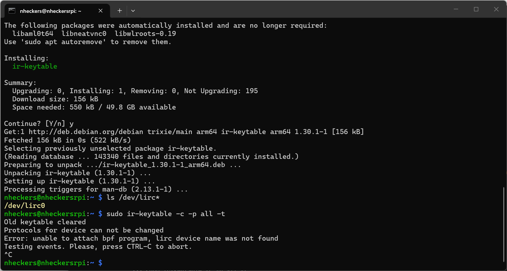

# Raspberry Pi IR Receiver

Capturing and decoding infrared remote signals on a Raspberry Pi using a TSOP38238 IR receiver. This is the first part of a larger project to control my Roku TV and LED strip from my phone through a web remote hosted on the Pi.

## Parts

- Raspberry Pi (running Raspberry Pi OS)
- TSOP38238 IR receiver (38 kHz)
- Breadboard and jumper wires
- Roku TV remote (for testing)

## Wiring

| TSOP38238 leg | Raspberry Pi pin |
|---|---|
| VCC | Pin 1 (3.3V) |
| GND | Pin 6 (GND) |
| OUT | Pin 11 (GPIO 17) |



## Step 1: Wiring to Raspberry Pi

- Power off the Pi before wiring.
- With the dome of the TSOP38238 facing you, the legs are OUT, GND, and VCC from left to right.
- Connect the VCC leg to Pin 1 of the Pi (3.3V).
- Connect the GND leg to Pin 6 of the Pi (GND).
- Connect the OUT leg to Pin 11 of the Pi (GPIO 17, General Purpose Input/Output).
- Power on the Pi and SSH into it.

```bash
ssh <username>@<pi-ip-address>
```

## Step 2: Enable the IR Driver

Edit the `config.txt` file in the firmware folder:

```bash
sudo nano /boot/firmware/config.txt
```

Under the `[all]` section, add:

```
dtoverlay=gpio-ir,gpio_pin=17
```

This loads the `gpio-ir` kernel driver and watches GPIO 17 (Pin 11). The driver watches for every high and low change on that pin and sends the pulse lengths to `/dev/lirc0`, where the kernel's decoders turn them into scan codes.

Save, then reboot:

```bash
sudo reboot
```

## Step 3: Install Tools and Confirm It Is Detected

After connecting back to the Raspberry Pi, run:

```bash
sudo apt update
sudo apt install ir-keytable v4l-utils
ls /dev/lirc*
```

You should see `/dev/lirc0` if the driver successfully found the receiver.

## Step 4: Capture Decoded Codes

Use the following command to begin capturing signals sent to the receiver:

```bash
sudo ir-keytable -c -p all -t
```


### Issue 1: Wrong device

I ran into an issue with this command because no device was specified. This leads the Pi to automatically assume you are trying to talk to `rc0`, the HDMI-CEC device. CEC does not let you set IR protocols, and we get the error `unable to attach bpf program` because `-p all` tries to load extra decoders, and that fails on the HDMI-CEC device. Using `sudo ir-keytable`, I was able to find the name of the IR receiver and changed the command I used.

```bash
sudo ir-keytable
```


I was able to run the following command afterwards to begin capturing IR signals from the remote:

```bash
sudo ir-keytable -s rc1 -c -p nec,rc-5,rc-6,sony -t
```

### Issue 2: Physical pin vs GPIO number

I ran into an issue here where I was unsuccessful with getting the IR signals from the remote. It turns out I had incorrectly connected the output of the TSOP38238 to Pin 17 of the Raspberry Pi, which is a fixed 3.3V power pin, instead of Pin 11, which is GPIO 17. Running the `pinout` command shows both the physical pin numbers and GPIO (BCM) numbers.


### Raw capture

```bash
sudo ir-ctl -r -d /dev/lirc0
```


## Captured Codes (Roku TV Remote)

The remote uses the **NECx** (extended NEC) protocol. Every code starts with the device address `0xeac7`, followed by the button's command byte.

| Button | Pressed | Held |
|---|---|---|
| Power | `0xeac717` | `0xeac797` |
| Back | `0xeac766` | `0xeac7e6` |
| Home | `0xeac703` | `0xeac783` |
| Up | `0xeac719` | `0xeac799` |
| Left | `0xeac71e` | `0xeac79e` |
| Right | `0xeac72d` | `0xeac7ad` |
| Down | `0xeac733` | `0xeac7b3` |
| OK | `0xeac72a` | `0xeac7aa` |
| Reverse | `0xeac778` | `0xeac7f8` |
| Sleep | `0xeac762` | `0xeac7e2` |
| Settings | `0xeac761` | `0xeac7e1` |
| Rewind | `0xeac734` | `0xeac7b4` |
| Pause/Play | `0xeac74c` | `0xeac7cc` |
| Skip | `0xeac755` | `0xeac7d5` |
| Netflix | `0xeac752` | `0xeac7d2` |
| Hulu | `0xeac74d` | `0xeac7cd` |
| Sling | `0xeac706` | `0xeac786` |
| Now | `0xeac76c` | `0xeac7ec` |

**Pattern:** every "held" code is the "pressed" code plus `0x80`. The remote sets the top bit of the command byte to signal that the button is still being held.

## Findings: Roku Remote Controls My LED Strip

Both the **Up** and **Netflix** buttons on the Roku remote trigger a response on my LED strip. Both devices use 38 kHz IR, and the LED strip's cheap receiver accepts codes meant for the TV.

This shows that consumer IR has no authentication. Any device that can send the right code can control the device, which makes it vulnerable to simple replay attacks. Car key fobs and garage doors use rolling codes to prevent this.

## Next Steps

- [ ] Capture the LED strip remote's codes and compare them with the Roku's Up and Netflix codes
- [ ] Wire an IR LED with an NPN transistor and send captured codes from the Pi
- [ ] Control the Roku TV over the network using Roku's ECP API
- [ ] Build a Flask web remote for the TV and LED strip, reachable over WireGuard VPN
