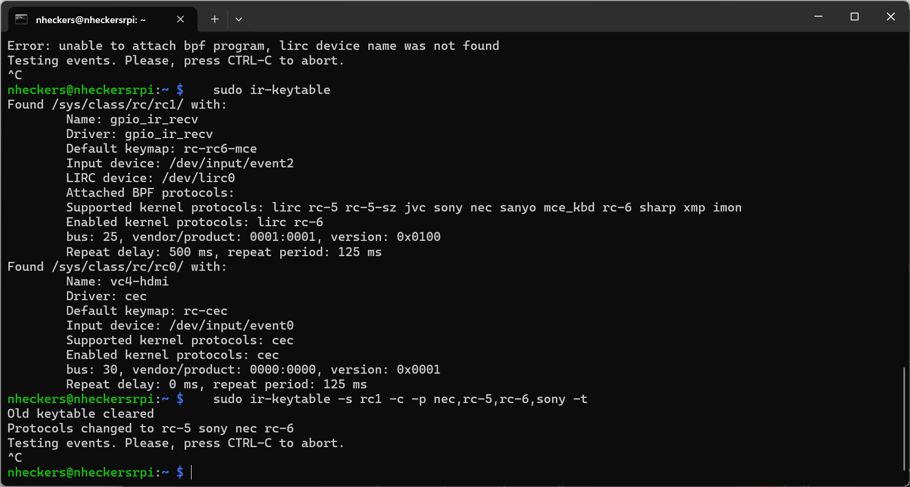
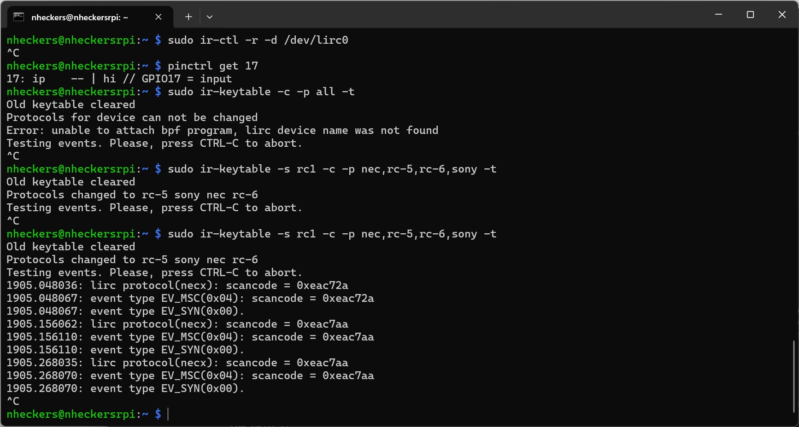
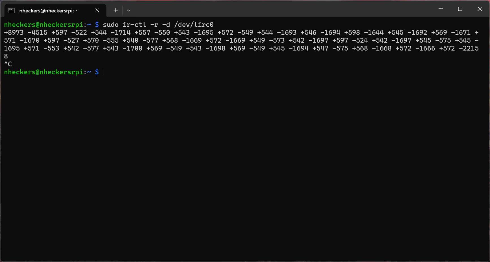
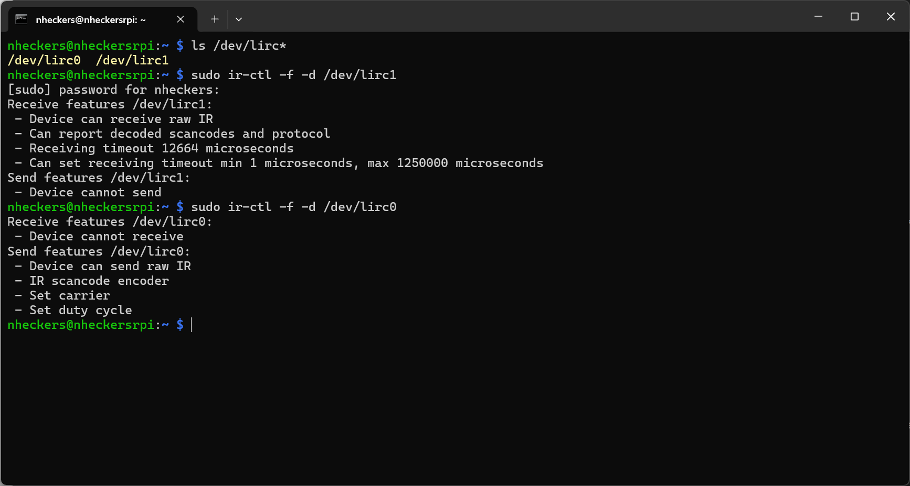
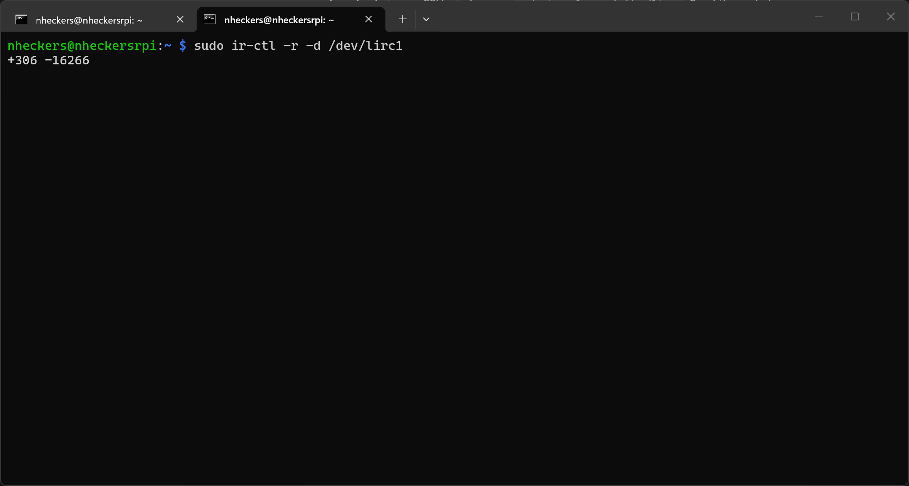
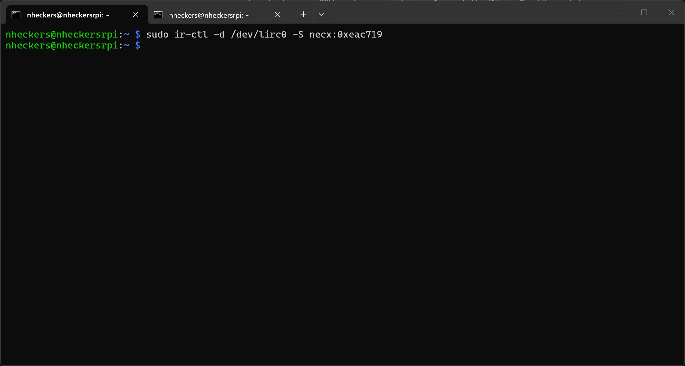

# Raspberry Pi IR Receiver and Transmitter

Capturing, decoding, and sending infrared remote signals with a Raspberry Pi. I started by capturing the codes from my Roku TV remote, then built a transmitter and used it to map out the codes for my LED strip after its remote stopped working. The end goal is to control both my TV and LED strip from my phone.

## Parts

- Raspberry Pi (running Raspberry Pi OS)
- TSOP38238 IR receiver (38 kHz)
- 940 nm IR LED
- 2N2222 NPN transistor
- 47 Ohm and 1 kOhm resistors
- Breadboard and jumper wires
- Roku TV remote (for testing)

## Wiring

**Receiver**

| TSOP38238 leg | Raspberry Pi pin |
|---|---|
| VCC | Pin 1 (3.3V) |
| GND | Pin 6 (GND) |
| OUT | Pin 11 (GPIO 17) |

**Transmitter**

| Connection | Raspberry Pi pin |
|---|---|
| 47 Ohm resistor → IR LED long leg (+) | Pin 2 (5V) |
| IR LED short leg (−) → transistor collector | |
| Transistor emitter | Pin 9 (GND) |
| 1 kOhm resistor → transistor base | Pin 12 (GPIO 18) |


## Step 1: Wiring to Raspberry Pi

- Power off the Pi before wiring.
- With the dome of the TSOP38238 facing you, the legs are OUT, GND, and VCC from left to right.
- Connect the VCC leg to Pin 1 of the Pi (3.3V).
- Connect the GND leg to Pin 6 of the Pi (GND).
- Connect the OUT leg to Pin 11 of the Pi (GPIO 17, General Purpose Input/Output).
- Power on the Pi and SSH into it.

```bash
ssh nheckers@<pi-ip-address>
```

## Step 2: Enable the IR Driver

Edit the `config.txt` file in the firmware folder:

```bash
sudo nano /boot/firmware/config.txt
```

Under the `[all]` section, add:

```
dtoverlay=gpio-ir,gpio_pin=17
```

This loads the `gpio-ir` kernel driver and watches GPIO 17 (Pin 11). The driver watches for every high and low change on that pin and sends the pulse lengths to `/dev/lirc0`, where the kernel's decoders turn them into scan codes.

Save, then reboot:

```bash
sudo reboot
```

## Step 3: Install Tools and Confirm It Is Detected

After connecting back to the Pi, run:

```bash
sudo apt update
sudo apt install ir-keytable v4l-utils
ls /dev/lirc*
```

You should see `/dev/lirc0` if the driver successfully found the receiver.

## Step 4: Capture Decoded Codes

Use the following command to begin capturing signals sent to the receiver:

```bash
sudo ir-keytable -c -p all -t
```


### Issue 1: Wrong device

I ran into an issue with this command because no device was specified. This leads the Pi to automatically assume you are trying to talk to `rc0`, the HDMI-CEC device. CEC does not let you set IR protocols, and we get the error `unable to attach bpf program` because `-p all` tries to load extra decoders, and that fails on the HDMI-CEC device. Using `sudo ir-keytable`, I was able to find the name of the IR receiver and changed the command I used.

```bash
sudo ir-keytable
```



I was able to run the following command afterwards to begin capturing IR signals from the remote:

```bash
sudo ir-keytable -s rc1 -c -p nec,rc-5,rc-6,sony -t
```

### Issue 2: Physical pin vs GPIO number

I ran into an issue here where I was unsuccessful with getting the IR signals from the remote. It turns out I had incorrectly connected the output of the TSOP38238 to Pin 17 of the Pi, which is a fixed 3.3V power pin, instead of Pin 11, which is GPIO 17. Running the `pinout` command shows both the physical pin numbers and GPIO (BCM) numbers.



### Raw capture

```bash
sudo ir-ctl -r -d /dev/lirc0
```



### Captured Codes (Roku TV Remote)

The remote uses the **NECx** (extended NEC) protocol. Every code starts with the device address `0xeac7`, followed by the button's command byte.

| Button | Pressed | Held |
|---|---|---|
| Power | `0xeac717` | `0xeac797` |
| Back | `0xeac766` | `0xeac7e6` |
| Home | `0xeac703` | `0xeac783` |
| Up | `0xeac719` | `0xeac799` |
| Left | `0xeac71e` | `0xeac79e` |
| Right | `0xeac72d` | `0xeac7ad` |
| Down | `0xeac733` | `0xeac7b3` |
| OK | `0xeac72a` | `0xeac7aa` |
| Reverse | `0xeac778` | `0xeac7f8` |
| Sleep | `0xeac762` | `0xeac7e2` |
| Settings | `0xeac761` | `0xeac7e1` |
| Rewind | `0xeac734` | `0xeac7b4` |
| Pause/Play | `0xeac74c` | `0xeac7cc` |
| Skip | `0xeac755` | `0xeac7d5` |
| Netflix | `0xeac752` | `0xeac7d2` |
| Hulu | `0xeac74d` | `0xeac7cd` |
| Sling | `0xeac706` | `0xeac786` |
| Now | `0xeac76c` | `0xeac7ec` |

**Pattern:** every "held" code is the "pressed" code plus `0x80`. The remote sets the top bit of the command byte to signal that the button is still being held.

## Step 5: Wire the Transmitter

- In this case I will be using a 2N2222 NPN transistor. With the flat side facing you and the legs down, the legs are E, B, C (Emitter, Base, Collector) from left to right.
- We will also need a 47 Ohm and a 1 kOhm resistor.
- Power off the Pi before wiring.
- Connect Pin 2 of the Pi (5V power out) to a 47 Ohm resistor, which will be connected to the positive leg (long leg) of the IR LED.
- Connect the negative leg (short leg) to the transistor collector.
- Connect the transistor emitter to Pin 9 of the Pi (GND).
- Connect Pin 12 of the Pi (GPIO 18) to a 1 kOhm resistor and connect that to the transistor base.

## Step 6: Enable the Transmit Driver

Again run:

```bash
sudo nano /boot/firmware/config.txt
```

Under the receiver line added earlier, add the following:

```
dtoverlay=gpio-ir-tx,gpio_pin=18
```

Save, exit, and then reboot once again.

Run the following command again, and you should now see two lirc devices labeled `lirc0` and `lirc1`:

```bash
ls /dev/lirc*
```

In order to figure out which device is now recognized as the receiver and which is the transmitter, run the following commands to see each device's capabilities:

```bash
sudo ir-ctl -f -d /dev/lirc0
sudo ir-ctl -f -d /dev/lirc1
```



> **Note:** Device numbers are not guaranteed to stay the same between boots or configuration changes, so always double check with `ir-ctl -f` instead of assuming. In my case, adding the transmitter made it `lirc0` and moved the receiver to `lirc1`.

Test that the system works by enabling the receiver and having the transmitter send out a signal through the IR LED.

Enable the receiver:

```bash
sudo ir-ctl -r -d /dev/lirc1
```

Have the transmitter send an IR signal (in my case the known Up button on the Roku remote):

```bash
sudo ir-ctl -d /dev/lirc0 -S necx:0xeac719
```




## Step 7: Sweep Script

In this next part, I tested a variety of IR signals to see which would affect my LED light strip, in order to control it with my Raspberry Pi instead, since the controller had broken. The script goes through each possible signal and waits for my response to a prompt asking whether something happened that I will document, if I should resend the signal, or if nothing happened. The script is saved at [`scripts/sweep.sh`](scripts/sweep.sh).

While running the script, I had to stop as I could not tell if a previous signal was interfering with new ones being sent. I updated the script to always send what I found to be a reset (`0xeac71c`) before it sent the new signal I was testing.

### LED Strip Codes

| Code | Result |
|---|---|
| `0xeac708` | Dimmed the lights |
| `0xeac70c` | Brightened the lights |
| `0xeac715` | Changed oscillation / made reactive to noise |
| `0xeac719` | Changed oscillation / color scheme |
| `0xeac71c` | Reset |
| `0xeac740` | Change color / color scheme |
| `0xeac742` | Red color |
| `0xeac745` | Power switch |
| `0xeac747` | Not sure / has different results |
| `0xeac74a` | Blue color |
| `0xeac752` | Green color |
| `0xeac75a` | Rotates through lighter colors |
| `0xeac75e` | Rotates through colors |

## Findings: Roku Remote Controls My LED Strip

Both the Up button and Netflix button on the Roku remote triggered a response on the LED strip. After testing the LED strip with all possible codes, it is clear the device the signal is coming from (in this case the Roku remote, `eac7`) does not matter. The LED strip ignores the address.

This shows that consumer IR has no authentication. Any device that can send the right command can control the device, which makes it vulnerable to simple replay attacks. Car key fobs and garage doors use rolling codes to prevent this.

## Goals for the Future

- [ ] Make this remote not just dependent on the Pi
- [ ] Control the Roku TV over the network using Roku's ECP API
- [ ] Build a web remote for the TV and LED strip, reachable from my phone over WireGuard VPN
